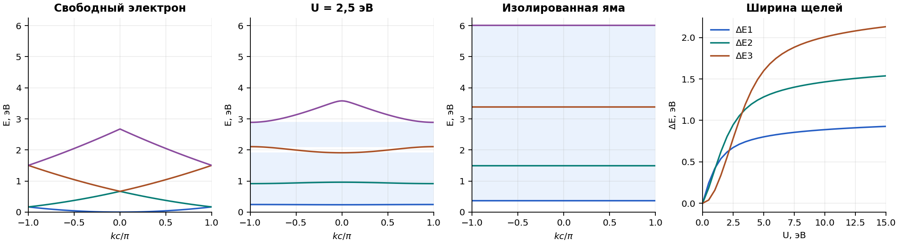

# Энергетические зоны в модели Кронига–Пенни

## Цель работы

Мы изучаем движение электрона в одномерном кристалле. Мы хотим увидеть, как меняются энергетические зоны и щели, когда растёт высота барьера. Сравниваем свободный электрон, конечный барьер и электрон в изолированной яме.

## Физическая модель

Кристалл состоит из одинаковых ячеек длиной c. В каждой ячейке есть яма шириной a и барьер шириной b = c − a. В яме потенциал V равен нулю, а на барьере V = U. Мы берём массу электрона mₑ.

Мы используем стационарное уравнение Шрёдингера −Aψ″ + Vψ = Eψ, где A = ℏ²/(2mₑ). Потенциал повторяется, поэтому мы считаем на одной ячейке. Для вектора Y = (ψ, ψ′)ᵀ задаём условие Блоха.

> Y(x + c) = exp(ikc) Y(x)

Мы строим графики в первой зоне Бриллюэна, где −π/c ≤ k ≤ π/c. В программе можно менять ширину ямы a от 0,35 до 2,75 нм, период c до 4 нм и высоту барьера U от 0 до 15 эВ. Минимальная ширина барьера равна 0,1 нм.

## Как мы считаем

На каждом участке V постоянно, поэтому мы решаем уравнение точно. Через участок длиной d волновую функцию и её производную переносит матрица со строками (C, S) и (−q²S, C), где q² = (E − V)/A.

- При q² > 0 берём q = √(q²). Тогда C = cos(qd) и S = sin(qd)/q.
- При q² < 0 берём κ = √(−q²). Тогда C = cosh(κd) и S = sinh(κd)/κ.
- При q² = 0 получаем C = 1 и S = d.

Мы перемножаем матрицы для ямы и барьера и получаем матрицу M за один период. Её определитель равен единице. Чтобы найти D(E) = tr(M)/2, мы складываем элементы на диагонали и делим сумму на два. Энергия входит в разрешённую зону, если ∣D(E)∣ ≤ 1.

1. Сначала ищем границы зон. В центрах ямы и барьера задаём ψ = 0 или ψ′ = 0. Получаем четыре комбинации. Если чётность на двух концах одинаковая, решение периодическое. Если чётность разная, оно антипериодическое. Для каждой комбинации ищем корни методом деления пополам. Так мы находим даже очень узкие зоны.
2. Для каждого k ищем энергию E внутри интервала зоны. Тем же методом решаем D(E) = cos(kc). При высоком барьере масштабируем матрицы, чтобы числа в расчёте оставались небольшими.
3. Строим первые пять зон. Ширину зоны считаем как разность Eₘₐₓ(n) − Eₘᵢₙ(n). Чтобы найти щель над ней, считаем Eₘᵢₙ(n + 1) − Eₘₐₓ(n). Для графика щелей меняем U с шагом 0,5 эВ при фиксированных a и c.

## Результаты

На первых трёх графиках мы сравниваем зоны в трёх режимах. Последний график показывает, как растут первые три щели. Для таблицы мы взяли a = 1 нм и c = 1,5 нм. Все энергии и ширины указаны в эВ.

| U   | Низ первой зоны | Ширина первой зоны |   Щель 1 |   Щель 2 |   Щель 3 |
| --- | --------------: | -----------------: | -------: | -------: | -------: |
| 0   |               0 |           0,167125 |        0 |        0 |        0 |
| 2,5 |        0,236441 |         0,00761640 | 0,672529 | 0,946936 | 0,781852 |
| 8   |        0,289806 |         0,00022446 | 0,863518 | 1,416118 | 1,914372 |
| 15  |        0,310115 |         0,00001223 | 0,927874 | 1,537515 | 2,130672 |
| ∞   |        0,376030 |                  0 | 1,128090 | 1,880151 | 2,632211 |

При U = 0 соседние зоны соприкасаются. При U = 2,5 эВ первая щель уже равна примерно 0,673 эВ, а при U = 15 эВ — 0,928 эВ. Первая разрешённая зона при U = 15 эВ примерно в 14 тысяч раз уже, чем при U = 0.

## Как мы проверили результат

- **Свободный электрон.** При U = 0 мы получаем ветви A(k + 2πj/c)², где j — целое число. В первой зоне Бриллюэна ветви пересекаются, поэтому все щели равны нулю.
- **Изолированная яма.** При U → ∞ зоны становятся всё уже. Энергии приближаются к A(πn/a)², где n — номер уровня. Щель между соседними уровнями равна Aπ²(2n + 1)/a². Эти значения мы указали в последней строке таблицы.
- **Конечный барьер.** При U = 2,5 эВ мы отдельно вычислили D(E) и сравнили его с cos(kc). На показанных ветвях величина ∣D(E) − cos(kc)∣ составила максимум около 3 × 10⁻¹⁴. Мы также проверили границы зон и точки внутри них на 150 наборах параметров.

### Проверка на сетке

Мы решаем то же уравнение методом конечных разностей. Делим период на N равных отрезков с шагом Δx = c/N. Заменяем ψ″ центральной разностью и усредняем V по ячейке каждого узла. Так мы учитываем скачок потенциала, даже если он лежит между узлами.

Для границ зон берём k = 0 и k = π/c. В первом случае условия Блоха периодические, во втором — антипериодические. Благодаря симметрии мы считаем только на половине периода. На её концах задаём ψ = 0 или ψ′ = 0. Получаем трёхдиагональную матрицу и по числу отрицательных опорных элементов находим, сколько энергий лежит ниже пробного E. Затем уточняем эти энергии делением пополам.

Программа сравнивает границы первых пяти зон с методом матриц переноса. В таблице мы взяли a = 1 нм, c = 1,5 нм и U = 2,5 эВ. Метод матриц переноса дал первую щель 0,672528891 эВ.

| Шагов на период | Первая щель, эВ | Макс. разница по границам, эВ |
| ---: | ---: | ---: |
| 192 | 0,672534383 | 0,002007154 |
| 384 | 0,672530267 | 0,000501861 |
| 768 | 0,672529235 | 0,000125470 |

Каждый раз, когда мы делим шаг пополам, максимальная разница становится примерно в четыре раза меньше. На самой мелкой сетке расчёт первой щели отличается от результата матриц переноса примерно на 3,4 × 10⁻⁷ эВ.

## Вывод

Чем выше барьер, тем труднее электрону пройти в соседнюю яму. Поэтому разрешённые зоны становятся уже. В наших примерах первые три щели растут и приближаются к разностям энергий уровней отдельной ямы. Их ширина зависит и от отношения a/c.
